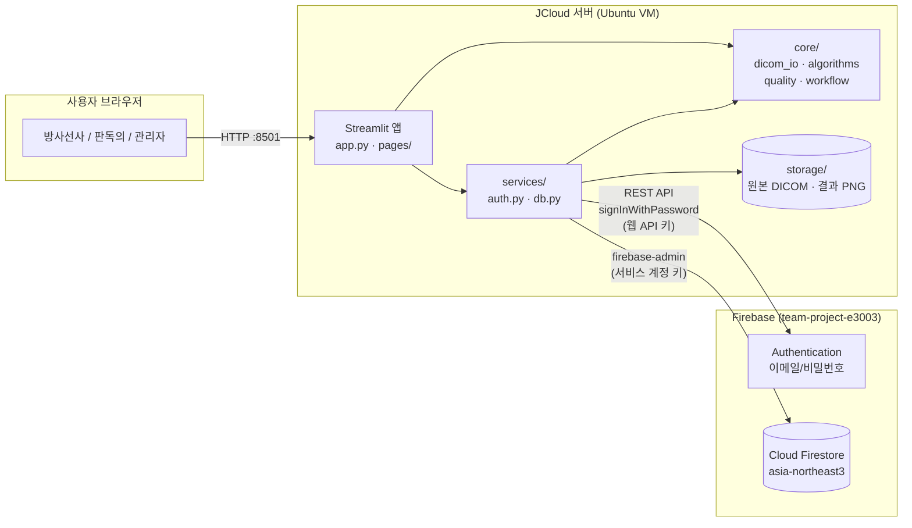
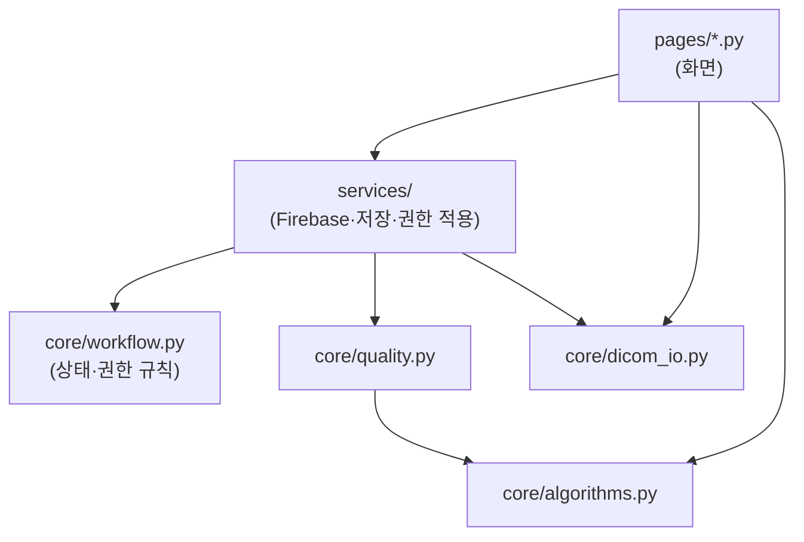
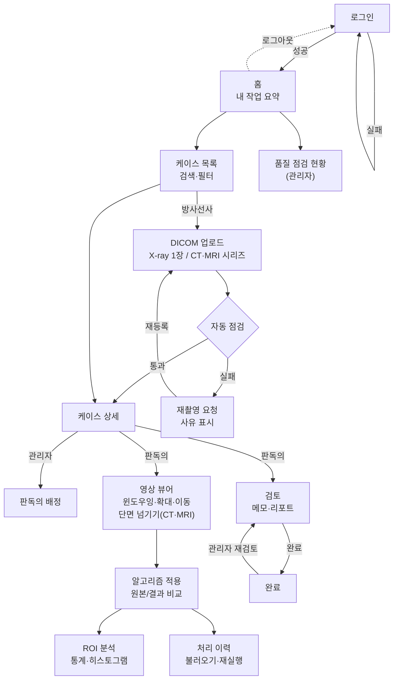
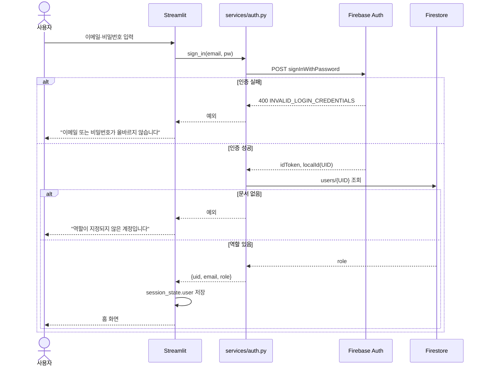
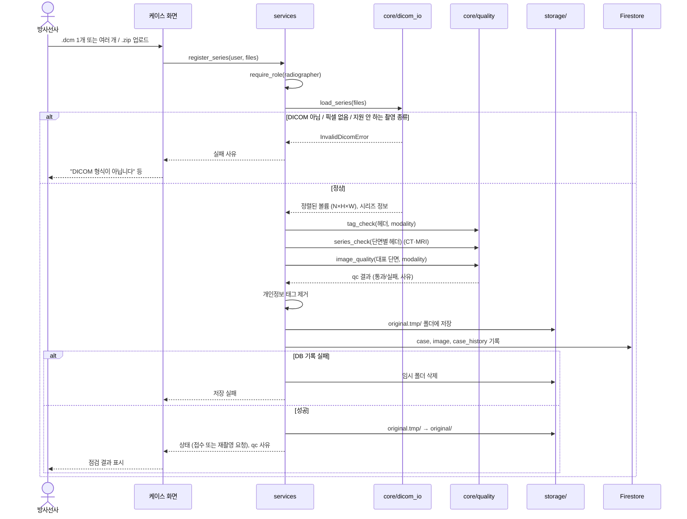
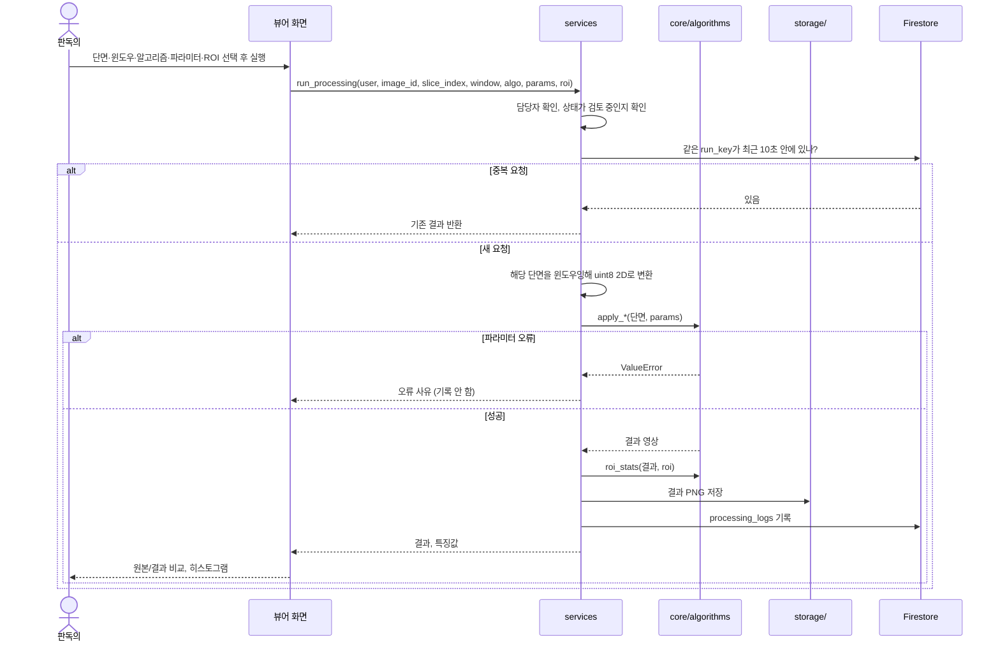

# 시스템 구조와 화면 흐름

> 보고서 **02 서비스·데이터 설계**(구성도, 화면 흐름)의 근거 자료입니다.

## 1. 시스템 구성도

| 구성 요소 | 기술 | 역할 |
|---|---|---|
| 화면 | Streamlit | 로그인, 목록, 뷰어, 검토 화면 |
| 서비스 계층 | `services/` | Firebase 연동, 파일 저장, **권한 검사 후** 데이터 변경 |
| 순수 로직 | `core/` | DICOM 변환, 알고리즘, 품질 점검, 상태 규칙. Firebase와 무관하게 pytest로 테스트할 수 있음 |
| 인증 | Firebase Authentication | 이메일/비밀번호 확인 |
| DB | Cloud Firestore | 업무 데이터 영구 저장 |
| 파일 | 서버 디스크 | 영상 파일 영구 저장 |

## 2. 모듈 구조와 의존 방향

- `core/`는 Streamlit과 Firebase를 import하지 않는다. 그래서 C가 Firebase 설정 없이 개발하고 테스트할 수 있다.
- 화면(`pages/`)은 Firestore를 직접 부르지 않고 항상 `services/`를 거친다. 그래야 권한 검사를 빠뜨리지 않는다.

## 3. 화면 흐름

| 페이지 파일 | 화면 |
|---|---|
| `app.py` | 로그인, 홈 |
| `pages/1_Cases.py` | 케이스 목록, 업로드, 케이스 상세, 배정 |
| `pages/2_Viewer.py` | 영상 뷰어, 알고리즘, ROI, 처리 이력 |
| `pages/3_Review.py` | 메모·리포트, 상태 변경, 케이스 이력 |

## 4. 주요 시퀀스

### 4.1 로그인

### 4.2 DICOM 등록과 자동 품질 점검 (특화 기능)

### 4.3 알고리즘 처리와 이력 저장

### 4.4 촬영 종류별 차이

등록·저장·처리·이력 흐름은 모든 촬영 종류가 같다. 아래 항목만 `modality` 값에 따라 달라진다.

| 항목 | X-ray (CR·DX) | CT | MRI (MR) | 위치 |
|---|---|---|---|---|
| 업로드 | 파일 1개 | 시리즈 파일 여러 개 / .zip | 시리즈 파일 여러 개 / .zip | `core/dicom_io.load_series` |
| 픽셀 값 | 장비마다 다름 | HU (Rescale 적용 후) | 단위 없음 | `core/dicom_io` |
| 기본 윈도우 | 헤더 값, 없으면 자동 | 프리셋: 폐·종격동·뼈·뇌 | 자동 (하위 1%~상위 1%) | `WINDOW_PRESETS`, `auto_window` |
| 뷰어 | 1장 | 단면 슬라이더 | 단면 슬라이더 | `pages/2_Viewer.py` |
| 품질 점검 | 지표 + 태그 | 지표(대표 단면) + 태그 + 시리즈 구성 | 지표(대표 단면) + 태그 + 시리즈 구성 | `core/quality.py` |
| 점검 기준 | `QC_THRESHOLDS["DX"]` | `QC_THRESHOLDS["CT"]` | `QC_THRESHOLDS["MR"]` | `core/quality.py` |

알고리즘(`core/algorithms.py`)은 항상 **uint8 2D 단면 1장**을 받으므로 촬영 종류와 상관없이 그대로 쓴다.

시리즈를 매번 디스크에서 다시 읽으면 단면을 넘길 때마다 느려진다. 한 번 읽은 볼륨은 `st.cache_data`로 `image_id` 기준 캐시한다.

## 5. 배포 구성 (JCloud)

| 항목 | 값 |
|---|---|
| 서버 | JCloud Ubuntu VM |
| 실행 | `streamlit run app.py --server.address 0.0.0.0 --server.port 8501` (백그라운드) |
| 열 포트 | 22 (SSH), 8501 (Streamlit) |
| 비밀 정보 | 서버에 직접 복사: `.streamlit/secrets.toml`, 서비스 계정 JSON |
| 영상 저장 | 서버 영구 디스크의 `storage/`. CT·MRI 때문에 여유 용량 수 GB 필요 |
| 업로드 한도 | `.streamlit/config.toml`의 `maxUploadSize = 500` (MB) |
| 업데이트 | `git pull` 후 앱 재시작 |

JCloud 접속이 확인되면 README의 배포 절차를 채운다.
