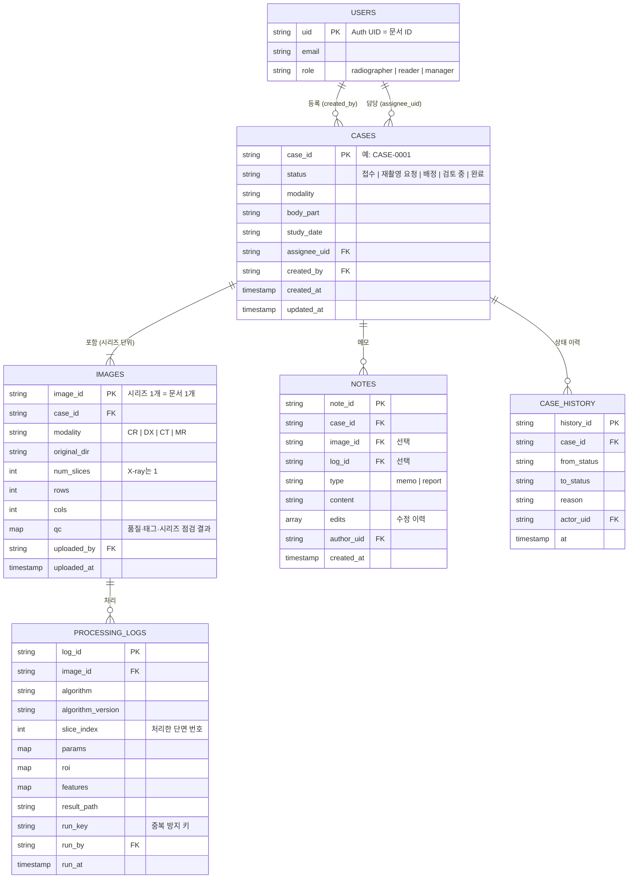

# 데이터 설계 (Cloud Firestore + 파일 저장소)

> 보고서 **02 서비스·데이터 설계**(Firestore 구조, 영상 저장 방식)의 근거 자료입니다.

## 1. 저장 역할 구분

| 저장소 | 저장하는 것 | 이유 |
|---|---|---|
| **Cloud Firestore** | 사용자·케이스·영상 메타데이터·처리 이력·메모·상태 변경 이력 | 검색·조회가 필요한 업무 데이터 |
| **서버 디스크** (`storage/`, JCloud 영구 디스크) | 원본 DICOM 파일, 처리 결과 PNG | 파일은 크기가 커서 DB에 맞지 않음. Firebase Storage는 유료 요금제가 필요할 수 있음 |

Firestore에는 파일 내용이 아니라 **파일 경로**만 저장한다.

## 2. ER 다이어그램



## 3. 컬렉션 상세

모든 컬렉션은 최상위에 둔다. 하위 컬렉션을 쓰지 않아 검색과 필터가 단순해진다.

### `users/{uid}`
| 필드 | 타입 | 예시 | 설명 |
|---|---|---|---|
| email | string | `user001@test.com` | Auth 계정 이메일 |
| role | string | `radiographer` | `radiographer` / `reader` / `manager` |

### `cases/{case_id}`
| 필드 | 타입 | 예시 | 설명 |
|---|---|---|---|
| status | string | `접수` | `workflow.md` 상태 이름 |
| modality | string | `CT` | DICOM (0008,0060). `CR`·`DX`·`CT`·`MR`. 목록 필터에 사용 |
| body_part | string | `CHEST` | DICOM (0018,0015) |
| study_date | string | `20240115` | DICOM (0008,0020) |
| assignee_uid | string \| null | `aB3x...` | 담당 판독의 |
| created_by | string | `Zk9q...` | 등록한 방사선사 |
| created_at / updated_at | timestamp | | |
| is_mock | bool | `true` | 모의 케이스 표시 (항상 true) |

### `images/{image_id}`
문서 1개 = **시리즈 1개**. X-ray는 단면이 1장인 시리즈로 저장한다.

| 필드 | 타입 | 예시 | 설명 |
|---|---|---|---|
| case_id | string | `CASE-0001` | |
| modality | string | `CT` | 점검 기준과 윈도우 기본값을 고르는 데 사용 |
| series_uid | string | `1.2.840...` | DICOM SeriesInstanceUID |
| original_dir | string | `storage/CASE-0001/IMG-xxx/original` | 원본 단면 파일 폴더, 수정 금지 |
| num_slices | int | `1` (X-ray) / `180` (CT) | |
| slice_files | array of string | `["0001.dcm", ...]` | **정렬된 순서**로 저장. 위치(mm)는 `slice_positions` |
| slice_positions | array of number \| null | `[-120.0, -118.75, ...]` | CT·MRI 단면 위치. X-ray는 null |
| rows / cols | int | `512` | |
| pixel_spacing / slice_thickness | array / number | `[0.7, 0.7]` / `1.25` | 거리 표시용, 없으면 null |
| window_center / window_width | number | `40` / `400` | 헤더 기본값. 없으면 촬영 종류별 기본값 |
| qc | map | 아래 참고 | 특화 기능 점검 결과 |
| is_current | bool | `true` | 재등록하면 이전 영상은 `false`가 되지만 지우지 않음 |
| uploaded_by / uploaded_at | string / timestamp | | |

`qc` 예시 (CT):
```json
{
  "result": "fail",
  "modality": "CT",
  "sampled_slices": [0, 45, 90, 135, 179],
  "brightness": 38.2, "contrast": 21.5, "sharpness": 12.7,
  "missing_tags": ["SliceThickness"],
  "phi_removed": ["PatientName"],
  "series": {"gaps": [{"after_index": 89, "position_mm": -6.25}], "duplicates": 0, "mixed_series": false},
  "issues": ["단면 누락 (위치 -6.25mm 부근)", "슬라이스 두께 태그 누락"],
  "thresholds_version": "v1"
}
```
X-ray는 `sampled_slices`가 `[0]`, `series`가 null이다.

### `processing_logs/{log_id}`
| 필드 | 타입 | 예시 |
|---|---|---|
| image_id | string | `IMG-xxx` |
| algorithm / algorithm_version | string | `CLAHE` / `1.0` |
| slice_index | int | `90` (X-ray는 `0`) |
| window | map | `{"center": -600, "width": 1500}` (처리 입력을 만든 윈도우. 재현에 필요) |
| params | map | `{"clip_limit": 2.0, "tile_size": 8}` |
| roi | map \| null | `{"x": 300, "y": 200, "w": 128, "h": 128}` |
| features | map | `{"mean": 112.4, "std": 30.1, "min": 10, "max": 250}` (CT는 `mean_hu` 추가) |
| result_path | string | `storage/CASE-0001/IMG-xxx/results/LOG-yyy.png` |
| run_key | string | 아래 5장 참고 |
| run_by / run_at | string / timestamp | |

히스토그램(256개 값)은 문서 크기를 줄이기 위해 저장하지 않고, 조회할 때 결과 파일에서 다시 계산한다.

### `notes/{note_id}`
| 필드 | 타입 | 설명 |
|---|---|---|
| case_id | string | 필수 |
| image_id / log_id | string \| null | 특정 영상·처리 결과에 대한 메모일 때 |
| slice_index | int \| null | 특정 단면에 대한 메모일 때 |
| type | string | `memo` / `report` (완료하려면 report 필요) |
| content | string | |
| edits | array of map | `[{"before": "...", "at": ts, "by": uid}]` |
| author_uid / created_at | string / timestamp | |

### `case_history/{history_id}`
| 필드 | 타입 | 설명 |
|---|---|---|
| case_id | string | |
| from_status / to_status | string | 등록 시 from은 null |
| reason | string \| null | T7, T9는 필수 |
| extra | map | 배정 변경이면 `{"from_uid", "to_uid"}` |
| actor_uid / at | string / timestamp | |

## 4. 파일 저장 구조와 일관성

```
storage/
├─ CASE-0001/                     # X-ray
│  └─ IMG-20261112-a1b2/
│     ├─ original/
│     │  └─ 0001.dcm              # 원본 (수정 금지)
│     └─ results/
│        └─ LOG-c3d4.png          # 처리 결과
└─ CASE-0002/                     # CT
   └─ IMG-20261112-e5f6/
      ├─ original/
      │  ├─ 0001.dcm              # 정렬된 순서로 이름을 다시 붙임
      │  ├─ ...
      │  └─ 0180.dcm
      └─ results/
         └─ LOG-g7h8.png          # 단면 1장의 처리 결과
```

**저장 순서**: 파일 먼저, DB 나중
1. 원본을 임시 폴더(`original.tmp/`)에 쓴다. CT·MRI도 폴더 하나라서 한 번에 처리된다
2. Firestore에 문서를 기록한다
3. 성공하면 임시 폴더 이름을 `original/`로 바꾼다
4. Firestore 기록이 실패하면 임시 폴더를 지우고 사용자에게 실패를 알린다

이렇게 하면 **DB에는 있는데 파일이 없는** 상황이 생기지 않는다. DB에 없는 남은 임시 폴더·파일(`.tmp`)은 앱이 시작할 때 정리한다.

**용량**: CT·MRI 시리즈 1개는 수십~수백 MB다. 업로드는 시리즈당 500MB로 제한하고(`.streamlit/config.toml`의 `maxUploadSize`), 시연용 데이터는 시리즈 2~3개로 한다. JCloud 디스크 용량을 확인한 뒤 조정한다.

## 5. 중복 실행 방지

- `run_key` = `image_id + slice_index + window + algorithm + 정렬된 params + roi`의 해시
- 처리를 실행하기 전에 같은 `run_key`가 최근 10초 안에 있으면 새로 기록하지 않고 기존 결과를 보여준다
- 상태 변경은 Firestore **트랜잭션** 안에서 현재 상태를 다시 읽고 확인한 뒤 바꾼다

## 6. 보안 규칙

앱은 서버에서 firebase-admin(서비스 계정)으로만 접근하므로, 클라이언트 접근은 모두 막는다.

```
rules_version = '2';
service cloud.firestore {
  match /databases/{database}/documents {
    match /{document=**} {
      allow read, write: if false;
    }
  }
}
```

firebase-admin은 이 규칙을 무시하므로 **권한 검사는 반드시 코드에서** 한다 (`workflow.md` 4장).

## 7. 필요한 복합 인덱스

| 컬렉션 | 필드 | 용도 |
|---|---|---|
| cases | `assignee_uid` ↑, `status` ↑, `updated_at` ↓ | 판독의 작업 목록 |
| cases | `status` ↑, `created_at` ↓ | 상태별 목록 |
| cases | `modality` ↑, `status` ↑, `created_at` ↓ | 촬영 종류별 목록 |
| processing_logs | `image_id` ↑, `run_at` ↓ | 영상별 처리 이력 |
| case_history | `case_id` ↑, `at` ↓ | 케이스 이력 |

쿼리를 처음 실행했을 때 Firestore 오류 메시지에 나오는 링크로 인덱스를 만들어도 된다.
