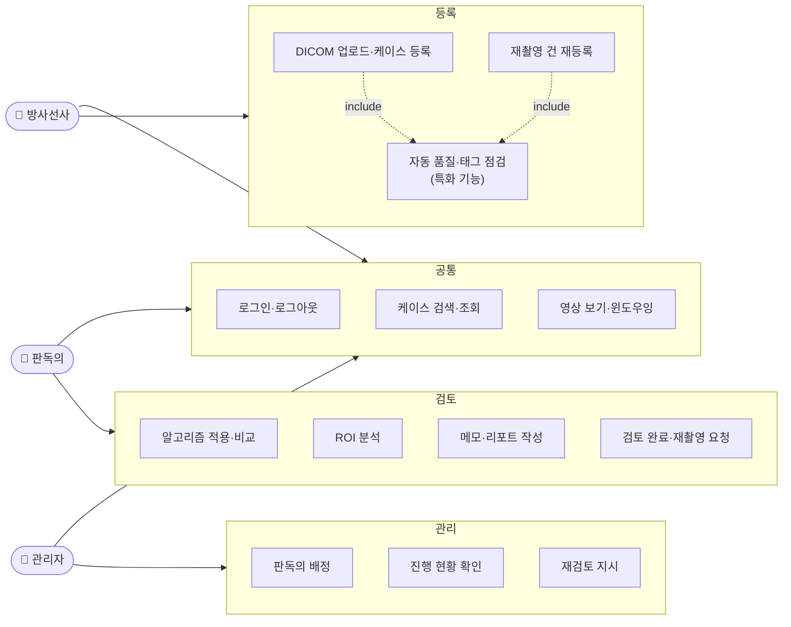

# 요구분석서

> 교육용 웹 PACS – 흉부 X-ray DICOM 영상 품질 점검
> 이 문서는 보고서 **01 문제와 업무 흐름**의 근거 자료입니다.

## 1. 개요

### 1.1 목적
공개 흉부 X-ray DICOM 데이터와 모의 케이스로 동작하는 **교육용 웹 PACS**를 만든다.
영상의 등록·검색·열람·처리·검토 흐름을 웹에서 구현하고, 등록 단계에서 **영상 품질과 DICOM 태그를 자동 점검**하는 특화 기능을 더한다.

### 1.2 범위

| 구분 | 포함 | 제외 |
|---|---|---|
| 영상 형식 | DICOM(.dcm) 2D 단일 프레임 흑백 영상 | 다중 프레임·3D(CT/MRI 볼륨), 컬러 영상 |
| DICOM 기능 | 파일 읽기, 픽셀 변환(Rescale, MONOCHROME1 반전), 윈도우잉, 주요 태그 추출 | DICOM 네트워크(C-STORE, C-FIND), 장비 연동, 표준 전체 구현 |
| 결과 저장 | 처리 결과 PNG, 처리 설정·특징값 | 결과를 DICOM으로 다시 저장 |
| 용도 | 교육·실습용 모의 업무 | 실제 진단, 임상 성능 주장 |

### 1.3 데이터
- 출처: RSNA Pneumonia Detection Challenge (Kaggle), 흉부 X-ray DICOM
- 이미 익명화된 공개 데이터만 사용하며, 이용 조건은 `docs/data.md`에 기록한다.
- 화면에 **"교육용 모의 케이스 – 진단용 아님"**을 항상 표시한다.

## 2. 사용자와 문제 정의

### 2.1 사용자(역할)

| 역할 | 코드 값 | 주요 업무 |
|---|---|---|
| 방사선사 | `radiographer` | 케이스·영상 등록, 품질 점검 결과 확인, 재촬영 요청 건 재등록 |
| 판독의 | `reader` | 배정된 영상의 처리·비교·ROI 분석, 메모·리포트 작성, 검토 완료 |
| 관리자 | `manager` | 판독의 배정, 진행 현황 확인, 완료 건 재검토 지시 |

### 2.2 업무 불편 (해결할 문제)

| # | 누가 | 상황 | 불편 |
|---|---|---|---|
| P1 | 판독의 | 흐리거나 너무 어둡고 밝은 영상이 그대로 등록됨 | 검토 단계에서야 발견해서 되돌려야 하고, 그만큼 시간을 낭비함 |
| P2 | 방사선사 | 등록할 때 영상 품질을 눈으로만 확인함 | 확인 기준이 사람마다 다르고 빠뜨리기 쉬움 |
| P3 | 관리자 | 필수 태그(검사 부위 등)가 빠지거나 개인정보 태그가 남은 파일이 섞임 | 누락과 유출 위험을 수작업으로 찾아야 함 |

### 2.3 해결 방향 (특화 기능)
등록 즉시 **영상 품질 지표**(밝기·대비·선명도)와 **DICOM 태그**(필수 태그 누락, 개인정보 잔존)를 자동 점검한다.
기준에 못 미치면 **사유를 표시하고 `재촬영 요청` 상태로 보낸다.** 이렇게 하면 문제 영상이 판독의에게 넘어가기 전에 걸러진다.

## 3. 기능 요구사항

우선순위: **필수** = 안내문 필수 구현 / **특화** = 팀 특화 기능 / **선택** = 시간이 남으면

### 3.1 인증·권한
| ID | 요구사항 | 역할 | 우선순위 | 담당 |
|---|---|---|---|---|
| FR-01 | Firebase Authentication 이메일/비밀번호로 로그인·로그아웃한다 | 전체 | 필수 | A |
| FR-02 | 로그인하면 Firestore `users`에서 역할을 읽어 세션에 저장한다 | 전체 | 필수 | A |
| FR-03 | 로그인하지 않은 사용자는 모든 페이지에서 로그인 화면으로 보낸다 | 전체 | 필수 | A |
| FR-04 | 데이터를 바꾸는 모든 함수에서 역할과 담당 범위를 **서버 코드로** 검사한다 (화면 숨김만으로 처리하지 않음) | 전체 | 필수 | A |

### 3.2 케이스·영상 관리
| ID | 요구사항 | 역할 | 우선순위 | 담당 |
|---|---|---|---|---|
| FR-10 | DICOM 파일을 업로드한다. DICOM이 아니거나 픽셀 데이터가 없으면 이유를 표시하고 거절한다 | 방사선사 | 필수 | B |
| FR-11 | DICOM 헤더(Modality, StudyDate, BodyPartExamined 등)로 케이스 정보를 자동으로 채운다 | 방사선사 | 필수 | B |
| FR-12 | 원본 파일은 덮어쓰지 않고 보존한다. 파일 위치는 Firestore에 기록한다 | 시스템 | 필수 | B |
| FR-13 | 케이스를 ID·검사일·상태·담당자로 검색하고 필터링한다 | 전체 | 필수 | B |

### 3.3 이미지 뷰어
| ID | 요구사항 | 역할 | 우선순위 | 담당 |
|---|---|---|---|---|
| FR-20 | 원본을 윈도우잉(Window Center/Width)해서 표시하고, 값을 조절할 수 있다 | 전체 | 필수 | B |
| FR-21 | 확대·축소·이동, 화면 초기화를 제공한다 | 전체 | 필수 | B |
| FR-22 | 원본과 처리 결과를 나란히 놓고 비교한다 | 판독의 | 필수 | B |

### 3.4 영상처리·ROI
| ID | 요구사항 | 역할 | 우선순위 | 담당 |
|---|---|---|---|---|
| FR-30 | 서로 다른 알고리즘 3종 이상을 파라미터와 함께 적용한다 (명암 조정: CLAHE / 잡음 제거: Gaussian·Median / 경계 추출: Canny·Otsu) | 판독의 | 필수 | C |
| FR-31 | ROI를 선택하면 좌표·크기·평균·표준편차·히스토그램을 표시한다 | 판독의 | 필수 | C (계산), B (화면) |
| FR-32 | 처리할 때마다 알고리즘·파라미터·ROI·결과 위치·특징값·실행자·시간을 이력으로 저장한다 | 시스템 | 필수 | B |
| FR-33 | 이전 처리 이력을 불러와 같은 설정으로 다시 실행할 수 있다 | 판독의 | 필수 | B |
| FR-34 | 잘못된 파라미터·ROI는 이유를 표시하고 실행하지 않는다 | 판독의 | 필수 | C |

### 3.5 검토 업무
| ID | 요구사항 | 역할 | 우선순위 | 담당 |
|---|---|---|---|---|
| FR-40 | 케이스 상태를 `workflow.md`의 전이 규칙대로만 바꿀 수 있다 | 역할별 | 필수 | A |
| FR-41 | 관리자는 판독의를 배정하거나 다시 배정한다 | 관리자 | 필수 | A |
| FR-42 | 작업 목록에서 **내가 처리할 업무**와 **완료된 업무**를 구분해 보여준다 | 전체 | 필수 | B |
| FR-43 | 케이스·영상·처리 이력에 메모를 남기고, 완료할 때 요약 리포트를 작성한다 | 판독의 | 필수 | B |
| FR-44 | 상태 변경과 메모 수정은 변경 전후·작성자·시간을 이력으로 남긴다 | 시스템 | 필수 | A |

### 3.6 특화 기능: 등록 시 자동 품질 점검
| ID | 요구사항 | 역할 | 우선순위 | 담당 |
|---|---|---|---|---|
| FR-50 | 등록할 때 밝기(평균)·대비(표준편차)·선명도(라플라시안 분산)를 계산하고 기준과 비교한다 | 시스템 | 특화 | C |
| FR-51 | 필수 태그 누락과 개인정보 태그(PatientName, PatientID, PatientBirthDate 등) 잔존을 점검한다 | 시스템 | 특화 | B |
| FR-52 | 점검 결과를 통과/경고/실패와 사유로 표시하고, 실패하면 `재촬영 요청` 상태로 보낸다 | 시스템 | 특화 | B, A |
| FR-53 | 남아 있는 개인정보 태그는 저장하기 전에 자동으로 지운다 | 시스템 | 특화 | B |
| FR-54 | 관리자는 점검 기준값(임계값)을 확인하고 바꿀 수 있다 | 관리자 | 선택 | B |
| FR-55 | 여러 영상의 점검 결과를 표로 비교하고, 실패 목록을 모아 본다 | 관리자 | 선택 | B |

## 4. 비기능 요구사항

| ID | 분류 | 요구사항 |
|---|---|---|
| NFR-01 | 보안 | 서비스 계정 키와 `secrets.toml`은 저장소에 커밋하지 않는다 |
| NFR-02 | 보안 | Firestore 보안 규칙은 클라이언트 접근을 모두 거부한다. 접근은 서버(firebase-admin)만 하고, 권한은 코드에서 검사한다 |
| NFR-03 | 영속성 | 앱을 다시 시작하거나 새로고침해도 원본·결과·이력을 다시 조회할 수 있다 |
| NFR-04 | 일관성 | 파일 저장과 DB 기록 중 하나만 실패해도 둘이 어긋나지 않게 정리한다 (`firestore.md` 4장) |
| NFR-05 | 중복 방지 | 버튼을 연속으로 눌러도 같은 처리·상태 변경이 두 번 기록되지 않는다 |
| NFR-06 | 오류 안내 | 모든 실패에 사용자가 이해할 수 있는 이유를 표시한다 |
| NFR-07 | 성능 | 1장(약 1024×1024)에 알고리즘 1개를 처리하는 데 3초 이내 |
| NFR-08 | 재현성 | README대로 하면 다른 팀원도 로컬 실행·테스트·배포를 할 수 있다 |
| NFR-09 | 배포 | JCloud에서 외부 접속이 되고, 채점 기간 동안 서비스를 유지한다 |
| NFR-10 | 표시 | 분석 수치와 점검 결과는 교육용이며 진단 결과가 아님을 표시한다 |

## 5. 유스케이스 다이어그램

방사선사는 **등록**, 판독의는 **검토**, 관리자는 **관리** 기능을 쓰고, **공통** 기능은 세 역할이 모두 쓴다.

## 6. 예외 상황 (안내문 9쪽 검증 항목 대응)

| 검증 상황 | 시나리오 | 기대 결과 | 관련 요구사항 |
|---|---|---|---|
| 정상 업무 흐름 | 등록 → 점검 통과 → 배정 → 처리 → 메모 → 완료 → 재조회 | 모든 단계가 연결되고 이력이 남음 | FR-10~44 |
| 로그인·권한 | 로그인하지 않고 URL로 접근 / 방사선사가 완료 처리 시도 | 로그인 화면으로 이동 / "권한 없음"으로 거절 | FR-03, FR-04 |
| 입력 실패 | PNG를 .dcm으로 이름만 바꿔 업로드 | "DICOM 형식이 아닙니다" 표시, 저장 안 함 | FR-10 |
| 처리 실패 | ROI 크기 0, 커널 크기 짝수 | 이유 표시, 실행·이력 기록 안 함 | FR-34 |
| 상태 오류 | `접수` 상태에서 바로 `완료` 시도 | 허용되지 않는 전이로 거절 | FR-40 |
| 중복 동작 | "처리 실행"을 빠르게 두 번 클릭 | 이력이 1건만 기록됨 | NFR-05 |
| 저장 실패 | 결과 파일은 저장됐는데 DB 기록이 실패 | 결과 파일을 지우고 실패를 안내 | NFR-04 |
| 재현 | 앱을 재시작한 뒤 이전 처리 이력 열기 | 같은 원본·설정·결과가 표시됨 | NFR-03, FR-33 |
| 특화 기능 | 흐린 영상과 PatientName이 남은 영상 업로드 | 사유 표시, `재촬영 요청` 상태, 개인정보 태그 제거 | FR-50~53 |

## 7. 평가 기준 추적표

| 평가 항목 (배점) | 대응 요구사항 | 근거 문서 |
|---|---|---|
| 문제 정의·업무 적합성 (15) | 2장, FR-40~44 | requirements.md, workflow.md |
| 핵심 기능 완성도 (25) | FR-10~22, FR-40~44 | architecture.md |
| 영상처리·분석·검증 (25) | FR-30~34 | `docs/experiments/` (C) |
| 특화 기능·참신성 (15) | FR-50~55 | 모의 업무 비교 결과 |
| Git 협업·재현·배포 (10) | NFR-08, NFR-09 | README, GitHub 기록 |
| 보고서·시연·개인 이해 (10) | 전체 | 보고서, 시연 영상 |
