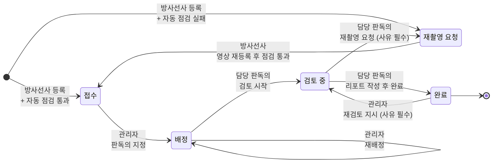

# 업무 흐름과 접근 권한

> 이 문서의 상태 이름과 역할 값은 `core/workflow.py`의 상수와 같습니다. 바꿀 때는 두 곳을 함께 수정하세요.
> 보고서 **01 문제와 업무 흐름**(상태전이도)과 **02 서비스·데이터 설계**(역할별 접근 권한)의 근거 자료입니다.

상태 규칙은 촬영 종류(X-ray·CT·MRI)와 상관없이 같다. CT·MRI는 시리즈 1개를 한 단위로 상태를 관리한다.

## 1. 상태 전이도



## 2. 상태 전이 규칙

| # | 현재 상태 | 다음 상태 | 실행 주체 | 조건 | 기록 |
|---|---|---|---|---|---|
| T1 | (없음) | 접수 | 방사선사 | DICOM 검사와 자동 점검 통과 | 케이스 생성, 점검 결과 |
| T2 | (없음) | 재촬영 요청 | 시스템 | 자동 점검 실패 (등록은 됨) | 실패 사유 |
| T3 | 재촬영 요청 | 접수 | 방사선사 | 새 영상을 등록하고 점검 통과. 이전 영상은 보존하고 전후 비교 표시 (FR-58) | 새 영상 ID, 이전 영상 ID |
| T4 | 접수 | 배정 | 관리자 | 판독의 1명 지정 | 담당자 |
| T5 | 배정 | 배정 | 관리자 | 다른 판독의로 변경 | 이전·새 담당자 |
| T6 | 배정 | 검토 중 | 담당 판독의 | 본인에게 배정된 건만 | – |
| T7 | 검토 중 | 재촬영 요청 | 담당 판독의 | 사유 입력 필수 | 사유 |
| T8 | 검토 중 | 완료 | 담당 판독의 | 요약 리포트가 있어야 함 | 리포트 ID |
| T9 | 완료 | 검토 중 | 관리자 | 사유 입력 필수 | 사유 |

- 위 표에 없는 전이는 모두 거절한다. 예: `접수 → 완료`, `완료 → 배정`
- 모든 전이는 `case_history`에 남긴다: 변경 전·후 상태, 실행자, 시간, 사유 (`firestore.md` 참고)
- 같은 전이 요청이 연속으로 들어오면, 현재 상태를 다시 확인해서 두 번째 요청은 거절한다 (NFR-05)

## 3. 역할별 권한표

✅ 허용 / 🔸 조건부 허용 / ❌ 거절

| 동작 | 방사선사 | 판독의 | 관리자 |
|---|---|---|---|
| 케이스 목록·검색 | ✅ 전체 | 🔸 본인 배정 건 | ✅ 전체 |
| 영상 보기·윈도우잉 | ✅ | 🔸 본인 배정 건 | ✅ |
| DICOM 업로드·케이스 등록 (T1, T3) | ✅ | ❌ | ❌ |
| 판독의 배정·재배정 (T4, T5) | ❌ | ❌ | ✅ |
| 검토 시작 (T6) | ❌ | 🔸 담당자만 | ❌ |
| 알고리즘 적용·ROI 분석 | ❌ | 🔸 담당자, `검토 중`일 때 | ❌ |
| 처리 이력 조회 | ✅ | 🔸 본인 배정 건 | ✅ |
| 메모 작성 | ❌ | 🔸 담당자, `검토 중`일 때 | ✅ (관리 메모) |
| 본인 메모 수정 | ❌ | 🔸 `완료` 전까지 | ✅ |
| 재촬영 요청 (T7) | ❌ | 🔸 담당자 | ❌ |
| 검토 완료 (T8) | ❌ | 🔸 담당자, 리포트 있음 | ❌ |
| 재검토 지시 (T9) | ❌ | ❌ | ✅ |
| 점검 기준값 변경 (FR-54) | ❌ | ❌ | ✅ |

## 4. 권한 검사 위치

화면에서 버튼을 숨기는 것과 별도로, **데이터를 바꾸는 서비스 함수 맨 앞에서** 검사한다.
실제 구현: T4~T9는 `services/review.py`, T1·T2는 `services/cases.py`의 `register_case`.
상태 확인과 저장은 Firestore 트랜잭션 안에서 함께 해서, 같은 요청이 두 번 와도 두 번째는 거절된다.
`tests/test_review.py`는 `user`를 받는 서비스 함수마다 권한 검사 테스트가 있는지 확인한다 (새 함수를 만들면 테스트도 추가).

```python
# 예시: 검토 완료 처리
def complete_review(user, case_id, report_id):
    require_role(user, READER)                      # 1) 로그인·역할 확인
    case = get_case(case_id)
    if case["assignee_uid"] != user["uid"]:         # 2) 담당 범위 확인
        raise PermissionDenied("본인에게 배정된 케이스가 아닙니다")
    if not can_transition(case["status"], DONE, user["role"]):  # 3) 상태 규칙 확인
        raise PermissionDenied("현재 상태에서 완료할 수 없습니다")
    ...                                             # 4) 저장 + case_history 기록
```

| 검사 | 실패 시 |
|---|---|
| 로그인 안 됨 | 로그인 화면으로 이동 |
| 역할 불일치 | "권한이 없습니다" 표시, 아무것도 저장 안 함 |
| 담당자 아님 | "본인에게 배정된 케이스가 아닙니다" 표시 |
| 허용 안 되는 전이 | "현재 상태(○○)에서는 △△할 수 없습니다" 표시 |
